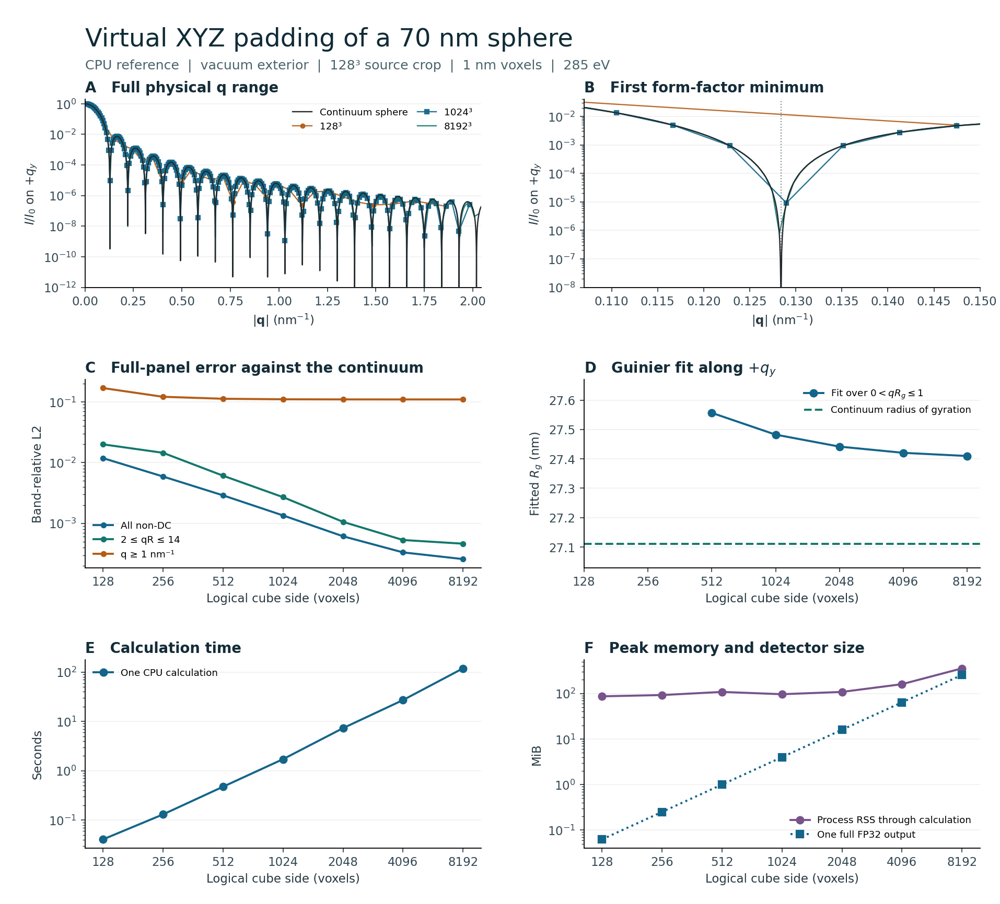

# Sphere reference measurements · 22 November 2026

A standalone CPU calculation evaluated the entire detector at every rung for the vacuum sphere. It uses one real scalar fraction field, complex64 phased XY FFTs, and the two axial sums needed by each valid detector pixel. Every valid intensity was compared to the polarized continuum sphere. The performance columns are one CPU trial per size, with a fresh Linux process each time. The production CuPy timing, GPU VRAM and matched incumbent comparisons belong to [ZP08](ZP08-sphere-ladder.md).

| Cube | Valid detector pixels | CPU calculation (s) | Peak host RSS through calculation (MiB) | Relative L2, all non-DC | Relative L2, q ≥ 1 nm⁻¹ | Fitted first minimum (nm⁻¹) |
|---:|---:|---:|---:|---:|---:|---:|
| 128 | 2,725 | 0.041 | 86.8 | 1.184% | 16.84% | Unresolved |
| 256 | 10,877 | 0.131 | 92.5 | 0.590% | 12.10% | 0.133217 |
| 512 | 43,537 | 0.475 | 108.4 | 0.289% | 11.23% | 0.128899 |
| 1024 | 174,093 | 1.718 | 96.5 | 0.135% | 11.00% | 0.128971 |
| 2048 | 696,217 | 7.300 | 108.4 | 0.0612% | 10.95% | 0.128522 |
| 4096 | 2,785,025 | 27.063 | 160.4 | 0.0333% | 10.94% | 0.128409 |
| 8192 | 11,140,041 | 118.664 | 356.7 | 0.0258% | 10.94% | 0.128397 |



[Full-precision CSV, including all three minima, DC and band statistics](ZP08-sphere-cpu.csv)

**What the 8192 result measures.** The nominal output has 67,108,864 pixels. Forward Ewald support at 285 eV admitted 11,140,041. One FP32 output accounts for 256 MiB of the process peak. The first minimum is 0.12839674 nm⁻¹ after interpolation, compared to 0.12838313 nm⁻¹ for a 35 nm radius. The discrete voxel anchor error at this rung is $4.36\times10^{-7} I_0$. Analysis of the bright low-q signal gives excellent overall agreement, while the weak high-q band retains a roughly 11% error relative to its own norm. Large padding factors improve Fourier sampling density while the sphere's voxel and boundary representation stay fixed. Attributing the remaining error calls for an independent change of voxel pitch or axial interpolation. Direct continuous-$q_z$ and finer-pitch controls are described in ZP08.

**Independent numerical cross-checks.** A literal complex128 3D FFT of the physical sphere and complementary matrix was evaluated over the full 128 and 256 detector panels for vacuum and material 2. The worst panel-relative L2 between the scalar pilot and the explicit FFT was $3.16\times10^{-7}$ (rounded up), the worst max absolute error/peak was $5.58\times10^{-7}$, and the largest literal-versus-direct anchor difference was $1.39\times10^{-10} I_0$. In the separate tensor/fill check 96 complex pre- and post-DC comparisons agreed to $6.45\times10^{-15}$ of peak or better. The alternative that subtracts the fill inside the crop and adds back the full-box transform passed the same 96 checks to $6.02\times10^{-15}$ of peak. This check includes an oriented material selected for an $S=0$ exterior at two energies and both lateral windows.

**Reproduce.** AMD EPYC 9V74, Linux x86-64, Python 3.12.14, NumPy 2.3.5 and SciPy 1.17.0. The transform uses one SciPy FFT worker. The table times only the complete detector calculation after constructing the occupancy array. Peak RSS includes interpreter, input, working buffers and the full output. The CSV also reports peak after separate scoring. Sphere occupancy sums to 179587.5 voxels and its little-endian float32 SHA-256 is `25548b6bd66496101501e5ebdc911417e31bc0f7d9679166753d805e928ede85`. A minimum without enough bracketing points and a Guinier fit with fewer than three points are left empty in the CSV.

```bash
lab=tests/validation/dev/cupy_rsoxs_virtual_3dpad
out=test-reports/virtual-3dpad/cpu-vacuum
export OPENBLAS_NUM_THREADS=1 OMP_NUM_THREADS=1
python "$lab/check_literal_sphere.py"
for m in 128 256 512 1024 2048 4096 8192; do
    python "$lab/residue_pilot.py" --size "$m" --evidence-dir "$out/M$m"
done
python "$lab/plot_sphere_ladder.py" "$out" --out "$out/figures"
```
