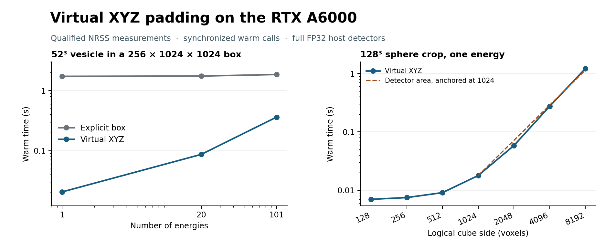

# What the current branch spends work on

## Multi-energy vesicle

The qualified comparison used the 52³ cropped H/T/water vesicle at 1.5 nm, a water exterior, and a logical `(256,1024,1024)` detector calculation on the RTX A6000. These are warm medians for one incident polarization direction and complete FP32 host output. The explicit arm used the full physical box. [GPU ledger, lines 113–132](https://github.com/usnistgov/NRSS/blob/bdf69e111a0e00d0adb2241067d949648d01e552/optimization/cupy_rsoxs/zpad_tickets/ZP05-09-RESULTS.md#L113-L132)

| Energies | Explicit | Virtual XYZ | Speedup over explicit | Endpoints in XYZ union | XYZ batched XY FFT calls |
|---:|---:|---:|---:|---:|---:|
| 1 | 1.730 s | 0.0205 s | 84.5× | 797,371 | 28 |
| 20 | 1.749 s | 0.0865 s | 20.2× | 1,937,851 | 28 |
| 101 | 1.856 s | 0.3614 s | 5.14× | 2,017,475 | 28 |

Going from 20 to 101 energies added 274.9 ms to XYZ, averaging 3.39 ms per added energy. The endpoint union grew 4.11%. The explicit run amortizes its much larger fixed transform cost. The XYZ batch still beats the previously recorded once-measured 101-call XYZ loop (2.344 s). Output chunk 4 gave 0.3630 s versus 0.3614 s at chunk 1. Both exported the same 404 MiB of detector values for 101 energies.

For an eligible full-depth FP32 automatic CuPy run, `Morphology` selects the compact tensor basis. `run` builds the basis once *per public invocation* before looping over energies. The runtime dispatch name for this padded evaluator is `virtual_3d_sum`. Look at the actual executed route when benchmarking, particularly with explicit path selectors. Real-space fields are energy-independent. Ewald support, optical weights, vector projection, axial weights and the output are energy-dependent. [Default selection](https://github.com/usnistgov/NRSS/blob/bdf69e111a0e00d0adb2241067d949648d01e552/src/NRSS/morphology.py#L468-L480) · [Public run](https://github.com/usnistgov/NRSS/blob/bdf69e111a0e00d0adb2241067d949648d01e552/src/NRSS/backends/cupy_rsoxs.py#L581-L674) · [Dispatch](https://github.com/usnistgov/NRSS/blob/bdf69e111a0e00d0adb2241067d949648d01e552/src/NRSS/backends/cupy_rsoxs.py#L2175-L2233)

## Evidence for targeting endpoint reuse

In the virtual planner, each distinct energy constructs full-panel projection geometry. Within each block of 262,144 columns it appends the previous union and calls `unique` again. It discards that energy's geometry, sorts the combined blocks, then adds the DC stencil and maps the result to native Hermitian addresses. When projecting, `project_energy_fused` requests the energy geometry again. Its kernel binary-searches the global 64-bit endpoint index for both axial samples of every valid 3D pixel, contracts each sample with the energy-specific complex tensor weights, projects it, and blends the two intensities. The value recorded as `virtual_energy_masks` is the distinct-energy count. Measuring rebuilds and cache hits requires separate counters. [Virtual union](https://github.com/usnistgov/NRSS/blob/bdf69e111a0e00d0adb2241067d949648d01e552/src/NRSS/backends/_cupy_virtual_z.py#L39-L67) · [Basis setup](https://github.com/usnistgov/NRSS/blob/bdf69e111a0e00d0adb2241067d949648d01e552/src/NRSS/backends/_cupy_energy_basis.py#L240-L275) · [Search and projection](https://github.com/usnistgov/NRSS/blob/bdf69e111a0e00d0adb2241067d949648d01e552/src/NRSS/backends/_cupy_energy_basis.py#L34-L140) · [Geometry lifetime](https://github.com/usnistgov/NRSS/blob/bdf69e111a0e00d0adb2241067d949648d01e552/src/NRSS/backends/_cupy_energy_basis.py#L437-L475)

I recomputed the forward geometry on CPU using the branch's FP32 rounding and exact grid/border rules. For the published 282.55–292.55 eV scan in 0.10 eV steps, the independent result matches the GPU ledger's endpoint count exactly. These counts quantify potential reuse. ZP10–ZP15 measure the corresponding GPU times.

| CPU diagnostic, 101 energies | Value |
|---|---:|
| Valid at least once, distinct detector columns | 412,705 |
| Distinct FP32 values of squared transverse radius on that support | 31,128 |
| Two endpoint visits per valid pixel summed over the scan | 80,541,970 |
| Unique endpoint positions, including DC stencil | 2,017,475 |
| Positions if each column stores its entire min-to-max Z span, including DC | 2,017,539 (64 extra) |
| Adjacent sorted energies with identical endpoint pair, among jointly valid pixels | 97.03% |
| Adjacent sorted energies with at least one common endpoint | 99.98% |
| Width 4, endpoint visits / distinct positions summed *within each tile* | 3.72× |
| Width 8, same metric | 7.03× |

The detector can share an endpoint's **complex material-basis vector**. Each energy still computes its own optical contraction and intensity. The width-8 ratio counts requested samples, including final partial tiles. Hardware caches already serve some repeated reads. For a deliberately wide 250/285/570/850 eV control on `(256,512,512)` at 1.5 nm, only 3.72% of jointly valid adjacent pairs shared both bins and a contiguous span added 5,061,138 unused bins. That control warrants a sparse fallback. [Executable geometry probe](../../../tests/validation/dev/cupy_rsoxs_virtual_3dpad/probe_energy_endpoints.py) · [Machine-readable results](ZP10-15-probes.json)

## Increasing logical resolution

The qualified single-energy 128³ sphere used the complete logical panel for both vacuum and material 2. Vacuum results are shown here. Per-pixel rates include invalid pixels that still have public output slots.

| Logical cube | Warm XYZ | Nominal panel Mpixel/s | Occupied planes per nominal XY batch | Sampled GPU peak |
|---:|---:|---:|---:|---:|
| 1024³ | 0.0179 s | 58.6 | 16 | 476 MiB |
| 2048³ | 0.0583 s | 71.9 | 4 | 584 MiB |
| 4096³ | 0.2743 s | 61.2 | 1 | 1,076 MiB |
| 8192³ | 1.2165 s | 55.2 | 1 | 3,428 MiB |

The 4096→8192 step multiplies output area by 4 and wall time by 4.43. The GPU path calls `rfft2(..., s=(My,Mx))` on every occupied-plane batch and captured real basis field. It evaluates each demanded Z endpoint with an axial dot over the occupied planes. Between batches each endpoint gets a global partial sum. A fixed 64 MiB *real-plane* target and a one-plane minimum put both upper rungs into one-plane batches. At 8192 a single real plane already takes 256 MiB, and the projector writes a 256 MiB host detector. CuFFT work area, output and endpoint buffers are additional. At this rung the branch reported 22,280,083 endpoints in a 534,722,040-byte basis and 11,140,041 valid pixels. These numbers justify testing both the current transform and the cost of traversing/writing the union 128 times per captured field. [Evaluator](https://github.com/usnistgov/NRSS/blob/bdf69e111a0e00d0adb2241067d949648d01e552/src/NRSS/backends/_cupy_virtual_xyz.py#L17-L102) · [GPU sphere and incumbent controls](https://github.com/usnistgov/NRSS/blob/bdf69e111a0e00d0adb2241067d949648d01e552/optimization/cupy_rsoxs/zpad_tickets/ZP05-09-RESULTS.md#L78-L110)

The 52³ vesicle to lateral 1024 has a ratio of 19.69. A path restricted to integer multiples of the occupied crop would miss the principal workload. At this size, changing Z from 256 to 1024 with a fixed 1024² detector moved the two-energy vesicle from 24.26 to 26.09 ms. Vary Z and XY separately when interpreting cubic scaling. [Vesicle shape controls](https://github.com/usnistgov/NRSS/blob/bdf69e111a0e00d0adb2241067d949648d01e552/optimization/cupy_rsoxs/zpad_tickets/ZP05-09-RESULTS.md#L59-L75)
